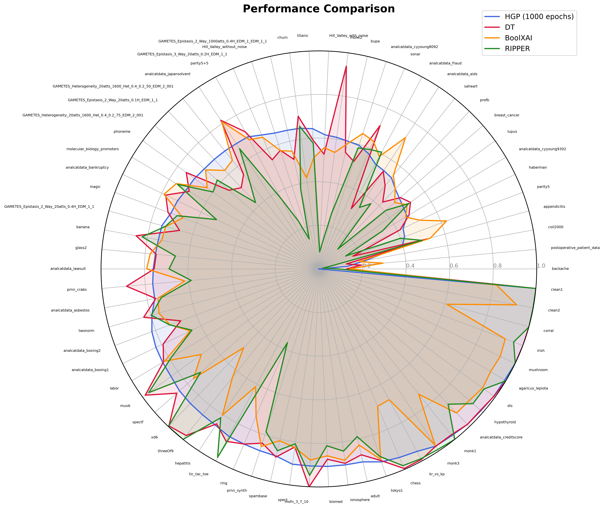
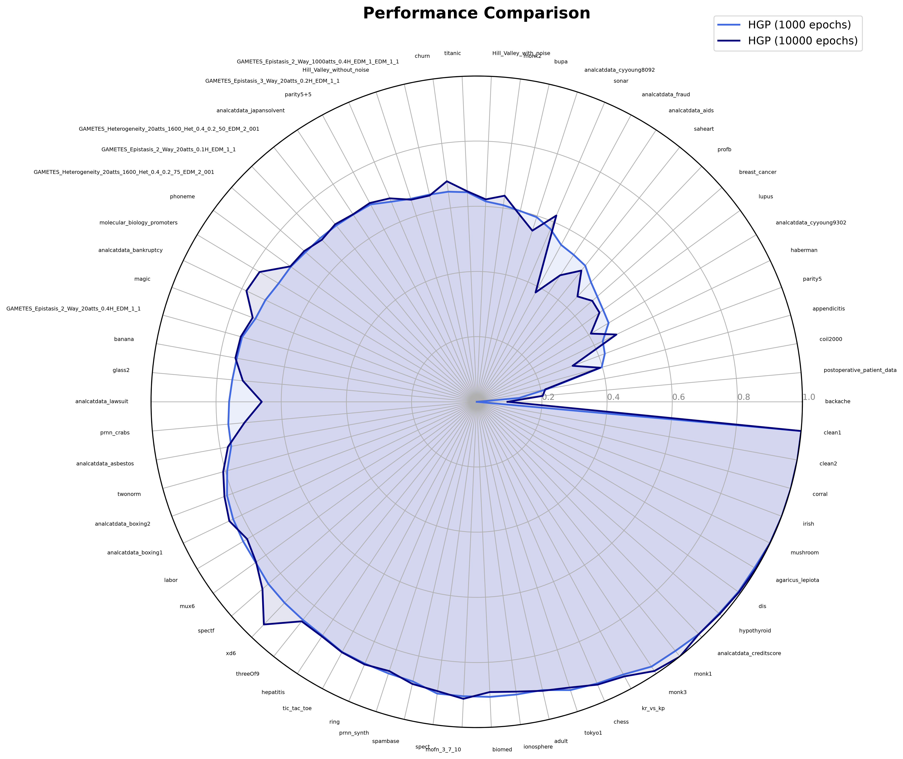

# PMLB

The [Penn Machine Learning Benchmarks](https://github.com/EpistasisLab/pmlb) (PMLB) is a curated collection of benchmark datasets for evaluating machine learning methods.
HGP is evaluated on the binary classification datasets in the suite.

## Data preparation

The preprocessing script lives at [`scripts/preprocess/pmlb_preprocess.py`](https://github.com/fii-optim-lab/hgp-lib/blob/master/scripts/preprocess/pmlb_preprocess.py).
It fetches a named dataset with the `pmlb` package and writes it to the data folder as an HDF file.

```bash
python scripts/preprocess/pmlb_preprocess.py breast_cancer --data_path data
```

This writes `data/breast_cancer.hdf`.

The list of binary classification datasets comes from the PMLB summary table.
The same query is used by the batch runner to decide which datasets to process.

```python
from pmlb.dataset_lists import df_summary

binary_datasets = df_summary[df_summary["n_classes"] == 2.0]["dataset"].tolist()
```

!!! warning
    Some datasets listed in older PMLB summaries are no longer available, because they were removed as duplicates.
    Fetching such a dataset raises an error.
    Skip the missing datasets and continue with the rest.

## Running a benchmark

Benchmark the Boolean GP on a single preprocessed dataset with `scripts/run_benchmark.py`.

```bash
python scripts/run_benchmark.py --data_path data/breast_cancer.hdf
```

See `python scripts/run_benchmark.py --help` for the full list of options.

## Hyperparameter tuning

Tune a single dataset with the Optuna script.
The study name keeps trials grouped, and artifacts are written to the artifact directory.

```bash
python scripts/optuna_hypertuning.py \
    --data_path data/breast_cancer.hdf \
    --study_name pmlb_breast_cancer \
    --n_trials 25 \
    --max_n_trials 25 \
    --n_runs 5 \
    --n_folds 3 \
    --artifact_dir ./artifacts
```

## Running on all datasets

The [`scripts/run_pmlb_comparison.py`](https://github.com/fii-optim-lab/hgp-lib/blob/master/scripts/run_pmlb_comparison.py) script compares HGP with interpretable baselines on every binary classification dataset.

```bash
python scripts/run_pmlb_comparison.py --n_jobs 5
```

The script runs each method through [`scripts/run_on_pmlb.py`](https://github.com/fii-optim-lab/hgp-lib/blob/master/scripts/run_on_pmlb.py).
Missing datasets are downloaded from PMLB first.

Each method writes one CSV to `results/pmlb`.
For every dataset, it holds the mean and standard deviation of the test F1, the mean size and number of literals of the rule learned in each fold, and the runtime.
When all methods are done, the script prints the comparison tables, saves them to `results/pmlb/summary.md`, and saves radar plots of the per-dataset scores in the same folder.

BoolXAI pins numpy 1.26.4 and scikit-learn 1.5.2, so it needs to run in its own Python 3.10 or 3.11 environment.
The script looks for it in `.venv/boolxai`; pass another interpreter with `--boolxai_python`.

```bash
python3.11 -m venv .venv/boolxai
.venv/boolxai/bin/pip install "git+https://github.com/fidelity/boolxai.git" "pandas<3" tables pmlb tqdm
.venv/boolxai/bin/pip install --no-deps -e .
```

To tune HGP on every dataset with Optuna instead, run `scripts/run_on_pmlb.py` with its default model.
It builds one `optuna_hypertuning.py` command per dataset and runs `--n_jobs` of them at a time.

```bash
python scripts/run_on_pmlb.py --n_jobs 5
```

## Results on PMLB

Each method is scored with the F1 score on a held-out test set, averaged over 5 runs.
Each run makes a stratified 80/20 train/test split and runs 3-fold cross-validation on the training part.
The fold model with the best validation F1 is scored on the test set.

The HGP variants keep the library defaults, except for the number of epochs:

- HGP (1000 epochs): the library defaults.
- HGP (10000 epochs): the library defaults, trained ten times longer.

The baselines run with their default parameters:

- DT: the scikit-learn decision tree.[^sklearn]
- BoolXAI[^boolxai]: a local-search method that also evolves expressive Boolean formulas.[@boolxai2023][@boolxai2025]
- RIPPER: a greedy rule-set learner[@cohen1995fast], from the wittgenstein package.[^wittgenstein]

The tables report, for each method:

- **Mean rank**: the rank on each dataset, averaged over datasets. Rank 1 is the best score, and tied methods share their ranks.
- **Best or tied**: the number of datasets on which the method has the best score or ties for it.
- **Mean F1**: the test F1, averaged over datasets.
- **Mean literals**: the number of literals in the rule learned in each fold, averaged over folds, runs, and datasets.
- **Mean nodes**: the number of nodes in the same rule, literals and operators together.
- **Mean runtime (s)**: the time to run all runs and folds on one dataset, averaged over datasets.
- **HGP win rate**: the share of datasets on which the HGP variant scores strictly higher than the method.

The baseline models are counted as hgp-lib rules.
A decision tree becomes the disjunction of its paths to positive leaves, and a RIPPER rule set the disjunction of its rules.

### All methods

Every HGP variant ranks ahead of the baselines.
The decision tree grows without a depth limit, so its rules are by far the largest: 1173.7 nodes on average, and 92.8 on the median dataset.

| Method | Mean rank | Best or tied | Mean F1 | Mean literals | Mean nodes | Mean runtime (s) |
|:---|---:|---:|---:|---:|---:|---:|
| HGP (10000 epochs) | 2.31 | 26 | 0.7382 | 12.0 | 16.5 | 1549.1 |
| HGP (1000 epochs) | 2.63 | 15 | 0.7369 | 10.7 | 14.8 | 106.2 |
| DT | 2.67 | 24 | 0.7337 | 1097.4 | 1173.7 | 0.2 |
| BoolXAI | 3.56 | 10 | 0.6847 | 3.1 | 4.3 | 252.1 |
| RIPPER | 3.84 | 10 | 0.6441 | 21.2 | 29.0 | 17.4 |

### HGP against the baselines


| Method | Mean rank | Best or tied | Mean F1 | Mean literals | Mean nodes | Mean runtime (s) | HGP win rate |
|:---|---:|---:|---:|---:|---:|---:|---:|
| HGP (1000 epochs) | 1.99 | 30 | 0.7369 | 10.7 | 14.8 | 106.2 | - |
| DT | 2.11 | 27 | 0.7337 | 1097.4 | 1173.7 | 0.2 | 50.00% |
| BoolXAI | 2.80 | 12 | 0.6847 | 3.1 | 4.3 | 252.1 | 77.14% |
| RIPPER | 3.10 | 10 | 0.6441 | 21.2 | 29.0 | 17.4 | 68.57% |




| HGP variant | Mean rank | Best or tied | Win rate vs DT | Win rate vs BoolXAI | Win rate vs RIPPER |
|:---|---:|---:|---:|---:|---:|
| HGP (1000 epochs) | 1.99 | 30 | 50.00% | 77.14% | 68.57% |
| HGP (10000 epochs) | 1.94 | 33 | 52.86% | 75.71% | 71.43% |

### HGP versions


| Method | Mean rank | Best or tied | Mean F1 | Mean literals | Mean nodes | Mean runtime (s) |
|:---|---:|---:|---:|---:|---:|---:|
| HGP (10000 epochs) | 1.36 | 47 | 0.7382 | 12.0 | 16.5 | 1549.1 |
| HGP (1000 epochs) | 1.64 | 28 | 0.7369 | 10.7 | 14.8 | 106.2 |



[^sklearn]: scikit-learn `DecisionTreeClassifier`, <https://scikit-learn.org/stable/modules/generated/sklearn.tree.DecisionTreeClassifier.html>.
[^boolxai]: BoolXAI, <https://github.com/fidelity/boolxai>.
[^wittgenstein]: wittgenstein, <https://github.com/imoscovitz/wittgenstein>.

## References

\bibliography
